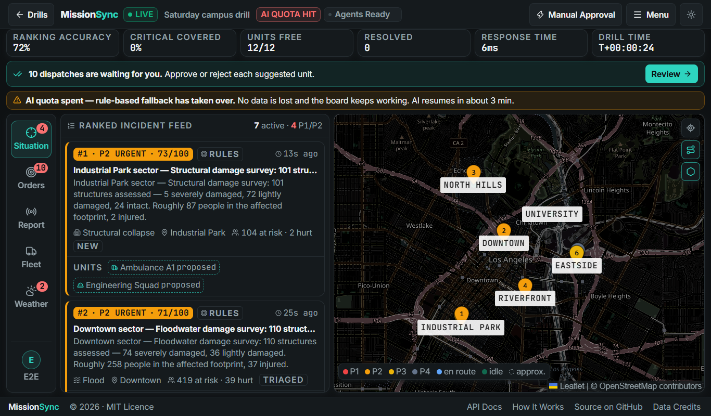
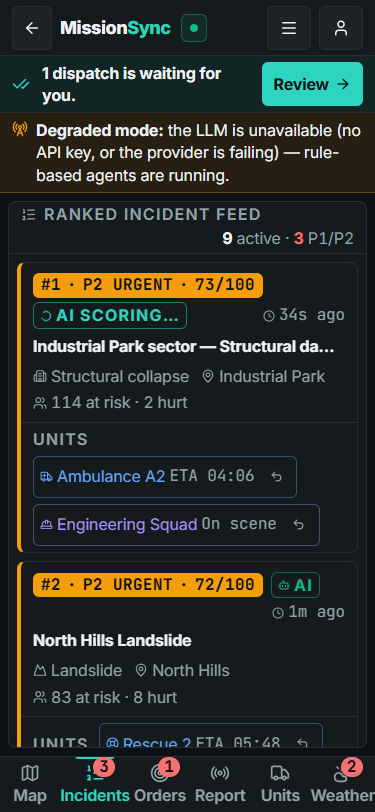
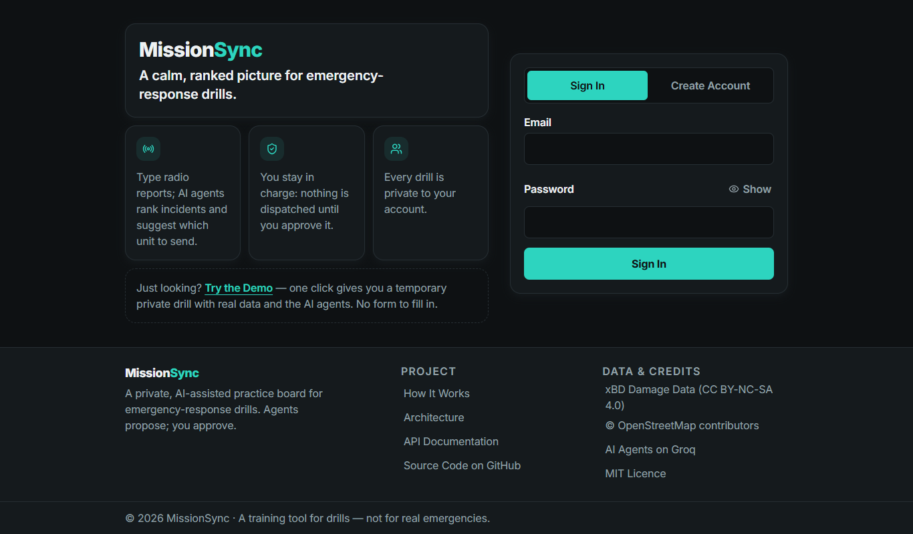
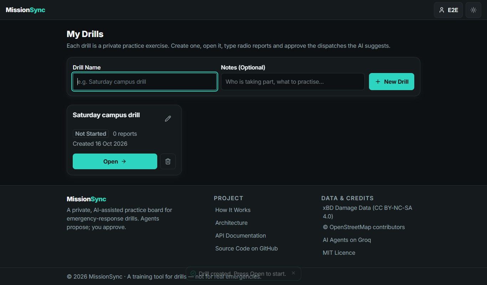
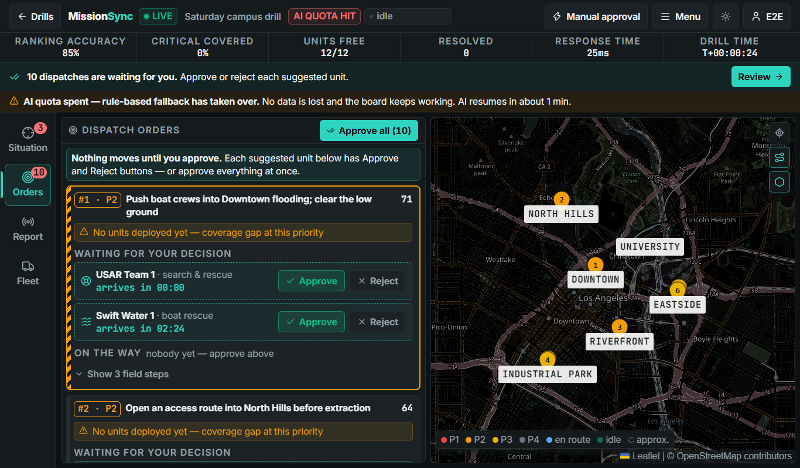
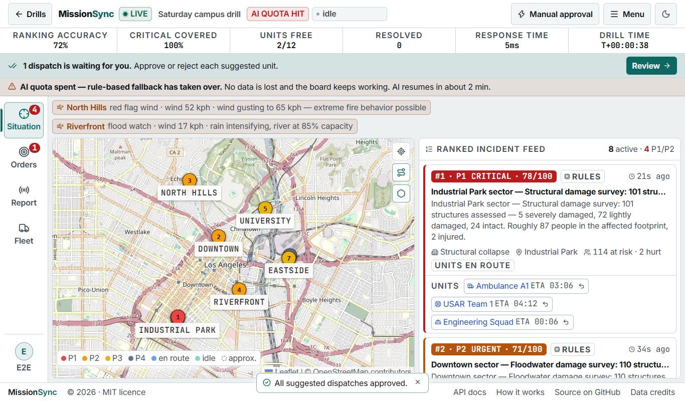

# MissionSync

> A private, AI-assisted practice board for emergency-response drills — type radio reports, see them ranked by urgency, and approve which unit goes where. For the net-control volunteers of CERT and amateur-radio teams.

[](https://missionsync.onrender.com)
[](https://github.com/sahinurrahman-debug/MissionSync)

---

## Preview

| Dashboard (desktop) | Dashboard (phone, 375 px) |
|---|---|
|  |  |

| Sign in | My drills | Approve dispatches | Light theme |
|---|---|---|---|
|  |  |  |  |

---

## What It Does

During a drill, the net-control lead of a campus CERT or amateur-radio team writes every radio call on paper and decides in their head which incident matters most and which team to send. MissionSync replaces the paper log: you create a private **drill**, type what field teams report, and the app turns each report into an incident, merges duplicates, scores it from 0 to 100 (P1 critical … P4 advisory) with an auditable breakdown, and proposes which unit to send with its ETA. AI agents only *propose* — nothing moves until you press **Approve**. Your drills, reports and audit trail are saved to your account and are invisible to everyone else.

Not ready to sign up? **[Try the demo](https://missionsync.onrender.com/demo)** — one click, no form: you get a temporary private account with its own drill running the real xBD scenario and the AI agents. It is deleted after 24 hours (or [create a free account](https://missionsync.onrender.com/signup) to keep your work).

---

## Features

- **Accounts and a one-click demo** — sign up, sign in and out with email and password (the session survives refreshes and is verified by the server on every request), or press *Try the demo* for a temporary guest account with its own drill.
- **Private drills (full CRUD)** — create, rename, open and delete your own drills; an account sees only its own.
- **Report intake** — free text becomes a structured, mapped incident in about 100 ms (rule-based), then the LLM refines the score in the background.
- **Ranked incidents with an auditable score** — severity, population, spread and time-criticality, each shown; the map and feed re-rank live.
- **Human-approved dispatch** — suggested units come with ETAs and Approve / Reject buttons; manual dispatch, recall and close are one click.
- **Live updates** — every pipeline stage is pushed over a WebSocket scoped to the one drill you are watching.
- **Self-explaining UI** — a "next step" bar says what to do now, a first-run walkthrough, one labelled menu, and a layout that works from 375 px up (side rail on desktop, tabs on phones, dark and light themes).
- **After-action record** — end a drill to freeze it, then download its audit trail and reports as CSV.

---

## Planning Docs

- [PRD](./docs/PRD.md) · [Architecture](./docs/ARCHITECTURE.md) · [API Spec](./docs/API_SPEC.md) · [Roadmap](./docs/ROADMAP.md) · [Requirements](./docs/REQUIREMENTS.md)
- [How it works — a guided tour of the code](./docs/HOW_IT_WORKS.md) · [Design system](./docs/DESIGN_SYSTEM.md) · [Sketch](./docs/SKETCH.md)

**Deviations from the plan:** Level 1 planned Firebase auth, organisations with roles and a separate static front end. Built instead: own email/password accounts with server-side sessions (no external service to configure), one account = its own private drills (roles and orgs are Shogun-level), and a single Docker service that serves both API and dashboard, because cookie sessions need one origin. Human-approved dispatch, a real FastAPI backend with LLM agents and real xBD data were pulled forward from later milestones. Details and reasons: [ARCHITECTURE.md §0](./docs/ARCHITECTURE.md).

---

## Architecture

```
Browser (React + Vite + Leaflet)
   │  one origin: page, REST API and WebSocket from the same host
   ▼
FastAPI (Docker on Render) ───────────────► Neon PostgreSQL
 ├─ /api/auth/*       sign up · in · out         users · sessions · drills
 ├─ /api/drills/*     CRUD + run a drill         audit_events · reports
 ├─ /ws/drills/{id}   live snapshots             (Alembic migrations)
 └─ DrillManager: one Orchestrator + hub per open drill ──► 5 agents ──► Groq LLM
```

The browser asks `/api/auth/session` who it is (the session cookie is checked against the `sessions` table), lists your drills, and opens one over REST + a WebSocket. Every action is checked against the drill's owner in SQL, changes only that drill's in-memory world, and is pushed to that drill's viewers; the world is saved back to the database so a restart resumes where you left off.

---

## Tech Stack

| Layer | Technology | Why |
|---|---|---|
| Frontend | React 18, TypeScript, Vite, React Router | Live-state UI; typed; route-level code splitting keeps the sign-in page light |
| Styling | Tailwind CSS with CSS-variable tokens | Two themes from one set of tokens; WCAG-AA contrast audited |
| Map / motion | Leaflet, Framer Motion | Free OpenStreetMap tiles; purposeful re-rank animation |
| Backend | FastAPI, Pydantic, SQLAlchemy 2, Alembic | Async + WebSocket, validated input on the server, versioned schema |
| Auth | argon2id, server-side sessions, `httpOnly` cookie | Revocable, unreadable by scripts, no tokens in `localStorage` |
| Database | PostgreSQL on Neon (SQLite for local dev) | Relational data with foreign keys; free tier that does not expire |
| AI | Groq `gpt-oss`, rule-based fallbacks | Fast JSON-mode agents; the board still works without the LLM |
| Data | Real xBD building-damage surveys | Scenarios with hidden ground truth to measure ranking accuracy |
| Tests / CI | pytest, Vitest, Testing Library, axe-core, GitHub Actions | See [Testing](#testing) |
| Deployment | Docker on Render | One service, one origin |

---

## Database Schema

```sql
users        (id, email UNIQUE, display_name, password_hash, is_guest, created_at)       -- argon2id hash, never the password; is_guest = temporary demo account
sessions     (id = sha256(cookie token), user_id → users ON DELETE CASCADE, created_at, expires_at, last_seen_at, user_agent)
drills       (id, owner_id → users ON DELETE CASCADE, name, notes, status, dataset,
              state JSON, state_updated_at, created_at, updated_at)                       -- state = the world, to resume a drill
audit_events (id, drill_id → drills ON DELETE CASCADE, seq, t, msg, created_at)
reports      (id, drill_id → drills ON DELETE CASCADE, text, source, kind, incident_title, tier, urgency, created_at)
kv           (key, value, updated_at)                                                     -- shared LLM score cache, no personal data
```

Migrations live in [`backend/migrations/`](./backend/migrations) (`0001` baseline, `0002` accounts & ownership, `0003` guest accounts) and run automatically on start; `alembic upgrade head` builds the schema from nothing.

---

## API Routes

| Method | Route | Auth | Description |
|---|---|---|---|
| POST | `/api/auth/signup` | – | Create an account and sign in (`201`) |
| POST | `/api/auth/login` | – | Sign in (`200`); rate-limited |
| POST | `/api/auth/demo` | – | One-click guest account with a ready drill (`201`); rate-limited, capped, auto-deleted |
| POST | `/api/auth/logout` · `/logout-all` | session | Revoke this session · every session of the account (`204`) |
| DELETE | `/api/auth/me` | session + password | Delete the account and all its drills (`204`) |
| GET | `/api/auth/session` · `/api/auth/me` | – · session | Current user (`null` for visitors) · strict `401` version |
| GET / POST | `/api/drills` | session | List your drills · create one (`201`, max 10) |
| GET / PATCH / DELETE | `/api/drills/{id}` | owner | Read · rename or edit notes · delete (`204`) |
| GET | `/api/drills/{id}/snapshot` | owner | The whole live picture |
| POST | `/api/drills/{id}/report` | owner | Submit a field report (idempotent, rate-limited) |
| POST | `/api/drills/{id}/dispatch/approve` · `/reject` · `/manual` | owner | Human-commit actions |
| POST | `/api/drills/{id}/units/{unit}/recall` · PATCH `/incidents/{inc}` | owner | Recall a unit · contain or close an incident |
| POST | `/api/drills/{id}/end` · `/reset` · `/settings` | owner | End · restart · toggle auto-dispatch |
| GET | `/api/drills/{id}/audit` · `/export.csv` | owner | Stored audit trail and reports · CSV |
| WS | `/ws/drills/{id}` | owner | Live snapshots |
| GET | `/api/health` | – | `{status, database, version}`; `503` when the database is unreachable |

Someone else's drill answers `404`, errors are `{"error": "sentence", "code": …, "request_id": …}`. Full contract: [API_SPEC.md](./docs/API_SPEC.md); interactive docs at `/docs` on any running server.

---

## Getting Started

Needs Python 3.11+ and Node 20.19+ (22 recommended). No database to install — local development uses a SQLite file.

```bash
git clone https://github.com/sahinurrahman-debug/MissionSync
cd MissionSync

# 1. Backend  (terminal 1)
cd backend
python -m venv .venv
.venv/Scripts/python -m pip install -r requirements.txt        # macOS/Linux: .venv/bin/python
cp .env.example .env                                            # optional: add GROQ_API_KEY for the AI agents
.venv/Scripts/python -m uvicorn missionsync.main:app --port 8000

# 2. Frontend (terminal 2)
cd frontend
npm install
npm run dev                                                     # http://localhost:5173 (proxies /api and /ws)
```

Open <http://localhost:5173>, create an account, create a drill, open it, and type: *"fire spreading near the University lab block, three trapped"*. Without a `GROQ_API_KEY` the rule-based agents run (the header says so).

---

## Environment Variables

Full list with comments: [`backend/.env.example`](./backend/.env.example), [`frontend/.env.example`](./frontend/.env.example).

| Variable | Description | Where to get it |
|---|---|---|
| `DATABASE_URL` | Postgres connection string; empty = local SQLite file | Neon dashboard → Connection string |
| `APP_ENV` | `production` turns on Secure cookies and refuses SQLite | set to `production` when deployed |
| `GROQ_API_KEY` | Enables the LLM agents (free tier: ~200k tokens/day/model, shared per organisation) | <https://console.groq.com/keys> |
| `MAX_DRILLS_PER_USER`, `MAX_LIVE_DRILLS` | Fair-use limits for a small instance | defaults 10 / 6 |
| `ALLOW_DEMO`, `GUEST_HOURS`, `MAX_GUESTS`, `GUEST_MAX_DRILLS` | The one-click demo: on/off, how long a guest lives, how many may exist, drills per guest | defaults true / 24 / 150 / 2 |
| `ALLOW_SIGNUP` | Close sign-ups on a shared server | default `true` |
| `TRUSTED_PROXY_HOPS` | Reverse proxies in front of the app. The client address for rate limits is that many entries from the **right** of `X-Forwarded-For`; `0` ignores the header | `1` on Render (in `render.yaml`), `0` locally |
| `MAX_BODY_BYTES`, `MAX_SESSIONS_PER_USER` | Largest request body · sign-ins an account may hold at once | defaults 65536 / 10 |
| `CORS_ORIGINS` | Only if the dashboard is hosted on a different origin | – |

No secret is committed; `.env` is git-ignored and `.env.example` lists every name with empty values.

---

## Auth Flow

1. **Sign up / in** — the server validates the body, hashes the password with argon2id (or verifies it, always doing a full hash so timing reveals nothing), creates a random 256-bit token, stores only its SHA-256 in `sessions`, and sets it as an `httpOnly`, `SameSite=Lax` (and `Secure` in production) cookie.
2. **Every request** — `current_user` hashes the cookie, finds the unexpired session, and loads the user; otherwise `401`. Drill routes then add `WHERE owner_id = <you>`.
3. **Sign out** — the session row is deleted, so a copied cookie stops working; *Sign Out Everywhere* deletes all of the account's sessions, and an open live socket re-checks its session every 15 s and closes when it is gone. An account holds at most 10 sessions (the oldest is signed out), and *Delete Account* asks for the password again.
4. **Protected routes** — the SPA redirects visitors from `/drills` to `/login` and returns them afterwards, but the guard is only a convenience: the server enforces access on every API call and WebSocket.

---

## Testing

| Suite | What it proves | Size |
|---|---|---|
| `backend/tests/test_isolation.py` | two accounts × every drill route (another user → `404`, anonymous → `401`), WebSocket refusals, listings | 36 |
| `backend/tests/test_auth.py`, `test_guest_demo.py` | validation per field, hashed passwords, cookie flags, revoked/expired/forged sessions, login rate limit, origin guard; guest demo: own drill, no re-login, limits, expiry clean-up | 30 |
| `backend/tests/test_drills_crud.py`, `test_play_api.py` | CRUD with server-side validation and limits, cascade delete, restart recovery, the whole report → approve flow | 22 |
| `backend/tests/test_migrations.py` | schema from scratch, idempotent, adopts the old database, downgrade/upgrade, the real `alembic` CLI | 8 |
| `backend/tests/test_hardening.py` | forged `X-Forwarded-For`, impossible ids, control characters, a refused audit line, sockets that close with their session, session cap, logout-all, account deletion, demo allowance, body limit, live-drill limit under concurrency, paused drills | 20 |
| remaining backend | agents, orchestrator, dispatch rules, persistence, WebSocket hub, security headers (CSP, HSTS), frontend-fixture drift, simulator, data, static serving | 104 |
| `frontend/src/**/*.test.*` | a slow server is not "signed out", account deletion, footer, account in the side rail, guards, inline validation, the one-click demo, optimistic create/rename/delete and approve with rollback, keyboard/ARIA, axe-core, WebSocket reconnect and snapshot ordering, no inline scripts under the CSP | 127 |
| `scripts/e2e_screens.mjs` | the real app in a headless browser: the demo (asks before it creates anything), sign up → drill → approve → refresh → end → sign out; footer on every page, account pinned in the rail, and **no sideways scrolling** on every page and tab at 1366 px and 375 px | 42 checks |

**220 backend tests (93 % line coverage) and 127 frontend tests (89 % statements); CI enforces minimum coverage, ESLint and a dependency vulnerability scan.** Lighthouse on the sign-in page: desktop 98 / 100 / 100 / 100 (performance / accessibility / best practices / SEO), phone 74 / 100 / 100 / 100 on a simulated slow-4G, 4× slower CPU.

```bash
cd backend  && .venv/Scripts/python -m pytest --cov=missionsync      # install requirements-dev.txt first
cd frontend && npm test && npm run typecheck && npm run lint && npm run audit:contrast
cd scripts  && npm install && node e2e_screens.mjs    # with the backend running and the dashboard built
```

CI ([`ci.yml`](./.github/workflows/ci.yml)) runs all of it plus the migration up/down/up check, `pip-audit`, a Docker build and (advisory) the browser walk-through; Dependabot keeps dependencies current.

---

## Deploy

One Render web service (Docker) plus a free Neon database:

1. Create a free project on [neon.tech](https://neon.tech) and copy its connection string.
2. Render dashboard → **New → Blueprint** → pick this repo. Set `DATABASE_URL` (Neon) and `GROQ_API_KEY` when asked.
3. Wait for the build (about 5 minutes). Migrations run on start. Open the URL, create an account.

Free-tier notes: the service sleeps after ~15 minutes idle (first request takes about a minute) and Groq's free quota can run out, in which case a banner says so and the rule-based agents carry on.

---

## What I Learned

The hardest part was making "no user can reach another user's data" true everywhere instead of in the one route I was looking at: the owner check lives in the SQL (`WHERE owner_id = …`) so a forgotten `if` cannot leak a drill, and a test tries *every* route as a second account and as a visitor. The second lesson was that cookie sessions force an architecture decision — two `*.onrender.com` hosts are cross-site, so private windows would silently fail to sign you in, which is why the dashboard is now served by the API on one origin. The third was that an AI coding assistant writes code far faster than anyone can understand it, so the project ships [HOW_IT_WORKS.md](./docs/HOW_IT_WORKS.md) — a guided tour with exercises — and keeps the tests strict enough to catch a wrong mental model. What I would change next: run drill simulations in a separate worker so a deploy never interrupts a live drill.

---

Code: [MIT](./LICENSE). Data and assets: see [NOTICE](./NOTICE) (the xBD data is CC BY-NC-SA — non-commercial).

*Submitted to Journey to Mastery — Level 3: Samurai*
